  

  
  
  
  

## 👋 Hey, I'm Amrit

- 🎓 4th-year B.Tech CSE student at Government College of Engineering, Keonjhar (2023 – 2027), Bhubaneswar, India
- 🧠 I build LLM apps and **measure whether they're actually good**: grounded answers, tracked quality, no guessing
- 🎬 4+ years as a freelance video editor and motion graphics artist for esports organizations
- 🏆 All India Rank 31 at the IIT Bombay E-Summit
- 📣 Learning in public, with weekly updates on what I learned and what broke

## 🧭 Where I'm headed

  

## 🚀 Projects

### 🔎 Production-Grade RAG System with Observability &nbsp;`in progress`

Ask questions over a document corpus and get answers that **cite the exact sources** behind them.

- **Hybrid retrieval:** BM25 keyword search plus Chroma vector search, merged and ranked
- **Quality is measured:** every change is scored with Ragas for faithfulness and answer relevancy
- **Everything is traced:** Langfuse follows each request end to end
- **Deploys are gated:** a GitHub Actions pipeline blocks releases when quality regresses

### 🧘 MindSync: AI-Powered Mental Wellness Platform

Track mood, energy, sleep and journal entries, with an LLM that writes journal reflections, spots patterns and works as a conversational wellness coach. Designed, built and deployed solo.

**[🌐 Live demo](https://mindsync.amritnayak.in)** &nbsp;·&nbsp; **[📂 Source code](https://github.com/amritkn2244/mindsync)**

-4169E1?style=flat-square&logo=postgresql&logoColor=white)

### 📰 truNews: AI News Summarizer with Personalized Feeds

An end-to-end pipeline that collects global news, summarizes it with a **local LLM** and serves each user a feed based on their interests, with **$0 in token costs**. Built as a two-person team project.

- **Local inference:** summaries and categories come from an Ollama-hosted model, so nothing depends on paid APIs and user interests stay on the machine
- **Automated ingestion:** an event-driven n8n workflow polls RSS feeds, removes duplicates by hash and sorts stories into Tech, Sports, Business and World
- **Fallback logic:** a regex backup handles cases where the model returns inconsistent formatting
- **Personalized dashboard:** a Next.js 15 app reads each user's saved preferences from Supabase and filters the summaries to match

**[📂 Source code](https://github.com/amritkn2244/truNews_news_summary)**

### ✂️ Koazy: AI Text Summarizer

Paste long text and get a concise summary in seconds, through a clean, responsive web interface.

- **Model:** summarization with Hugging Face Transformers (`facebook/bart-large-cnn`)
- **Fast API layer:** a FastAPI backend serves the model to a React and Tailwind frontend
- **Deployed:** frontend on Netlify, backend on Render

**[📂 Source code](https://github.com/amritkn2244/koazy_summarizer)**

### 🤖 Mod Bot: Discord Moderation Bot with ChatGPT

A Discord bot that handles moderation (kick, ban, mute and more) and doubles as a chat assistant: anyone can talk to it by mentioning it or replying to its messages.

**[📂 Source code](https://github.com/amritkn2244/mod_discord_bot)**

## 🛠 Tech stack

  &nbsp;&nbsp;
  &nbsp;&nbsp;
  &nbsp;&nbsp;
  &nbsp;&nbsp;
  &nbsp;&nbsp;
  &nbsp;&nbsp;
  &nbsp;&nbsp;
  &nbsp;&nbsp;
  &nbsp;&nbsp;
  &nbsp;&nbsp;
  &nbsp;&nbsp;
  &nbsp;&nbsp;
  &nbsp;&nbsp;
  

| Area | What I use |
|---|---|
| **AI / LLMs** | LLM APIs, LangChain, RAG, Hybrid Search (BM25 + vector), Chroma, Ollama (local LLMs), Hugging Face Transformers |
| **LLMOps** | Ragas (evaluation), Langfuse (tracing), GitHub Actions (CI/CD) |
| **Backend & Web** | Python, FastAPI, PostgreSQL, Supabase, React, Next.js, TypeScript, Tailwind CSS, JavaScript, HTML/CSS |
| **Automation** | n8n workflows, Discord bots |
| **Deploy** | Vercel, Render, Netlify, Neon |
| **Creative** | After Effects, DaVinci Resolve, Blender (3D) |

## 🤝 Beyond code

I'm the **Production Team Lead at my college's E-Cell**, running content from concept to delivery for college-wide events. Years of client work taught me to take feedback well and meet deadlines, and I bring the same ownership to every project.

## 💬 Let's talk

I'm open to AI/ML internships and always happy to hear advice from people already working in the field. Reach me on [LinkedIn](https://linkedin.com/in/amritkn2244) or at amritkn2244@gmail.com.
